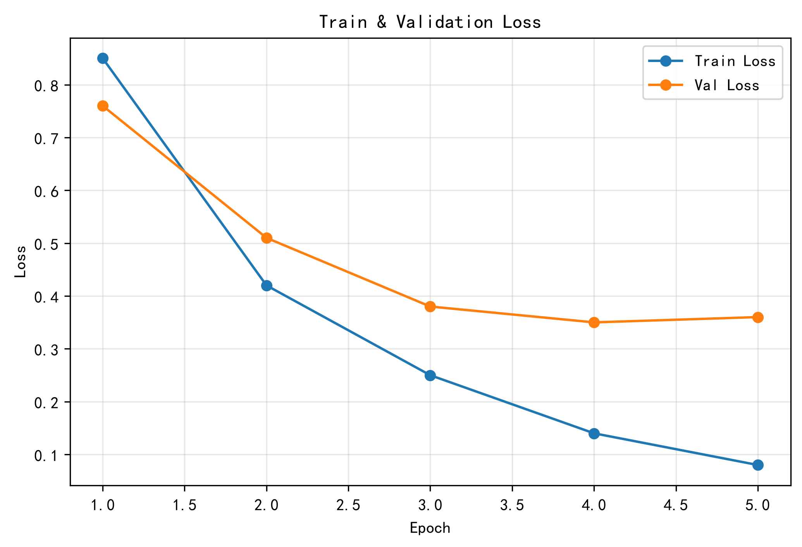
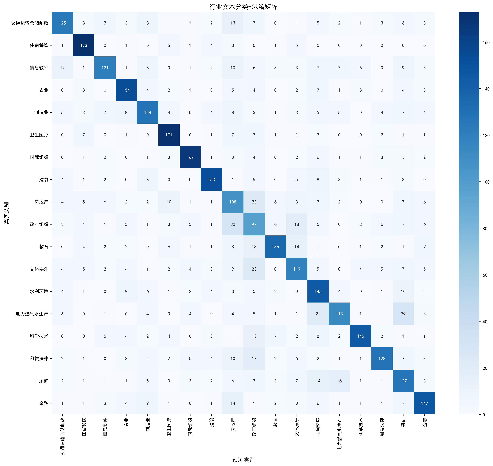

# BERT 中文文本分类项目 

## 项目简介 

基于 PyTorch 与 HuggingFace Transformers，以 bert‑base‑chinese 为基座构建模块化中文文本分类系统，面向海量中文文本自动分类场景。 项目完成代码解耦模块化设计，拆分模型、配置、数据处理、训练、评估、推理各个模块；使用 Pandas 完成 CSV 数据集清洗处理，构建训练与验证 DataLoader。 训练过程采用 AdamW 优化器、线性 Warmup 学习率调度，引入早停策略抑制模型过拟合；支持 Acc、Precision、Recall、macro‑F1 多维度指标评估，通过 Matplotlib 绘制损失曲线与混淆矩阵，自动保存最优模型 checkpoint。同时开展多组超参调优实验，对比学习率、batch_size、weight_decay 对模型效果的影响，筛选验证集F1最优的模型。 项目覆盖数据集诊断、标签修正、模型压缩量化、ONNX导出、API接口、Web可视化完整工程链路，代码可快速迁移至同类文本分类任务。

 **技术栈**：Python、PyTorch、Transformers、Pandas、NumPy、Scikit‑learn、Matplotlib 

## 可视化效果     项目功能 

中文文本分类模型训练，内置评估逻辑，输出 Acc / Precision / Recall / F1 指标 - 单条、批量文本预测推理 - 数据集诊断：BERT句向量聚类分析、疑似错误标签筛查、类别合并工具 - 人工标签修正脚本，清洗训练数据集噪声 - 模型压缩：动态int8量化、层剪枝，输出压缩前后指标对比报告 - 模型导出 ONNX 格式，便于部署 - Flask 后端推理接口，支持POST请求调用 - Streamlit 网页交互演示 - 支持切换 bert‑base‑chinese / chinese‑roberta‑wwm‑ext 预训练基座 - 脚本自动下载HuggingFace预训练权重 - 损失曲线、混淆矩阵结果可视化 

## 项目结构

src/

├── bert_classifier.py    # BERT 模型定义

├── train.py              # 训练脚本（内置 evaluate 评估函数）

├── predict.py            # 推理预测脚本

├── export_onnx.py        # 导出 ONNX 模型

├── compress.py           # 模型压缩、量化、剪枝评估

├── streamlit_app.py      # Streamlit 网页演示

├── download_model.py     # 自动下载预训练权重

├── config.py             # 参数配置文件

├── utils.py              # 数据集加载、工具函数

├── verify.py             # 环境链路快速验证

├── merge_classes.py      # 类别合并处理脚本

├── embed_cluster_probe.py # 句向量聚类，筛查可疑样本

├── apply_label_fixes.py  # 训练集标签修正脚本

├── app.py                # Flask 推理 API 服务

└── app_test.py           # 接口请求测试脚本

assets/

├── loss_curve.png        # 训练损失曲线图

└── confusion_matrix.png  # 混淆矩阵可视化图

requirements.txt          # 项目第三方依赖